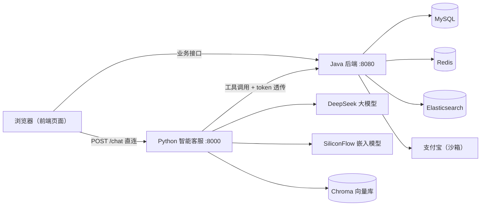

# 拾光优选 · 电商平台 + AI 智能客服

一个功能完整的单体电商项目，涵盖 **商品、秒杀、购物车、订单、支付、用户、收货地址** 等核心模块，并集成了基于大模型的 **AI 智能客服**（Agent + 工具调用 + RAG 知识库）。

前端为原生 HTML/CSS/JS，后端为 Spring Boot，AI 客服为独立的 Python 服务，三者通过 HTTP 交互。

---

## 一、架构图



- 前端页面由 Java 后端的 `static` 静态资源直接托管（无需单独部署前端）。
- 用户与 AI 客服聊天时，前端直连 Python 服务；Python 服务再以「工具调用」的方式回查 Java 后端的商品/订单/购物车/地址等接口。

---

## 二、技术栈

| 层 | 技术 |
|---|---|
| 后端 | Java 25、Spring Boot 4.0.5、MyBatis、MySQL、Redis（Lettuce + Redisson）、Elasticsearch（ik 分词）、JWT、支付宝 SDK |
| 前端 | 原生 HTML / CSS / JavaScript |
| AI 客服 | Python、FastAPI、LangChain Deep Agent、DeepSeek（对话）、SiliconFlow（嵌入）、Chroma（向量库） |
| 其他 | Maven（含 Wrapper）、knife4j（接口文档） |

---

## 三、功能特性

- **商品**：商品列表、详情、分类浏览、关键词搜索（ES + ik 分词）。
- **秒杀**：Redis 预扣库存 + Lua 脚本原子扣减 + Redis Stream 异步下单 + Redisson 分布式锁 + 超时回补。
- **购物车**：加入、改数量、勾选、清空。
- **订单**：创建订单、支付宝支付、取消订单、确认收货、后台发货、超时自动取消。
- **用户**：手机号 + 验证码登录、管理员登录、JWT 鉴权、角色权限（USER / ADMIN）、资料修改。
- **收货地址**：增删改查、设为默认。
- **缓存**：缓存穿透（空值）、缓存击穿（互斥锁重建）、逻辑过期。
- **AI 智能客服**：大模型 Agent 自动决策调用工具，查询真实业务数据回答用户；RAG 检索平台知识库。

---

## 四、目录结构

```
电商项目文件夹/
├── demo/                              # Java 后端（Maven 单体应用，含前端静态资源）
│   ├── src/main/java/com/example/demo/
│   │   ├── Controller/                # REST 接口
│   │   ├── Service/                   # 业务逻辑
│   │   ├── Mapper/                    # MyBatis Mapper
│   │   ├── pojo/                      # 实体类
│   │   ├── Filter/                    # JWT 登录过滤器
│   │   ├── Config/                    # 配置（支付宝/Redisson/ES/knife4j）
│   │   └── utils/                     # 工具类（JWT/锁/ID 生成等）
│   ├── src/main/resources/
│   │   ├── static/                    # 前端页面（index.html + css + js）
│   │   ├── Mapper/*.xml               # SQL 映射
│   │   ├── seckillOrder.lua           # 秒杀 Lua 脚本
│   │   ├── application.properties     # 主配置（占位符，可提交）
│   │   └── application-local.properties  # 本地真实配置（不入库）
│   └── pom.xml
├── ai-service/                        # Python 智能客服（独立服务）
│   └── agent智能化模块/
│       ├── main.py                    # FastAPI 入口（POST /chat）
│       ├── agent.py                   # LangChain Deep Agent + 系统提示词
│       ├── llm.py                     # DeepSeek 大模型客户端
│       ├── rag.py                     # 知识库文档 → 向量库 → 检索
│       ├── auth.py                    # token 透传（contextvars）
│       ├── config.py                  # 配置
│       ├── tools/                     # 工具函数（调 Java 接口）
│       ├── store_knowledge_base.txt   # 知识库文档
│       ├── .env                       # 真实 API Key（不入库）
│       └── .env.example               # 配置模板（可提交）
└── README.md
```

---

## 五、环境要求

- **JDK 25**（项目 `java.version=25`）
- **Maven**（可选，项目自带 Maven Wrapper `mvnw` / `mvnw.cmd`）
- **Python 3.12+**
- **MySQL 8**
- **Redis 7**
- **Elasticsearch 8**（**必须安装 ik 分词插件** `analysis-ik`，否则商品搜索/建索引会失败）

---

## 六、快速启动

### 1. 启动中间件

确保 MySQL、Redis、Elasticsearch（含 ik 插件）已启动。以 Docker 为例（示意）：

```bash
docker run -d --name mysql -p 3306:3306 -e MYSQL_ROOT_PASSWORD=你的密码 mysql:8
docker run -d --name redis -p 6379:6379 redis:7
# Elasticsearch 需带 ik 插件（可选用集成 ik 的镜像，或手动安装 analysis-ik）
```

### 2. 初始化数据库

建库建表（表结构脚本未包含在仓库中，需自行执行 DDL），涉及的表包括：
`pms_member`、`pms_product`、`oms_order`、`oms_order_item`、`oms_cart_item`、`user_address`、`seckill_goods`、`seckill_order`、`oms_order_package` 等。

### 3. 启动 Java 后端

```bash
cd demo

# Windows（使用 Maven Wrapper，首次运行会自动下载 Maven）
.\mvnw.cmd spring-boot:run "-Dspring-boot.run.profiles=local"

# macOS / Linux
./mvnw spring-boot:run -Dspring-boot.run.profiles=local
```

> 也可以打包运行：
> ```bash
> ./mvnw clean package -DskipTests
> java -jar target/demo-0.0.1-SNAPSHOT.jar --spring.profiles.active=local
> ```

启动成功后：
- 前端页面：<http://localhost:8080>
- 接口文档（knife4j）：<http://localhost:8080/doc.html>

### 4. 启动 Python 智能客服

```bash
cd ai-service/agent智能化模块

# 安装依赖（若仓库未含 requirements.txt，可手动安装下列依赖）
pip install fastapi "uvicorn[standard]" pydantic python-dotenv httpx \
            langchain langchain-core langchain-deepseek langchain-openai \
            langchain-chroma langchain-text-splitters deepagents

# 启动（必须在 agent智能化模块 目录内运行，端口固定 8000）
uvicorn main:app --host 0.0.0.0 --port 8000
```

> 注意：`main.py` 里的 import 是 `from agent import ...`、`from config import ...`，因此**必须在 `agent智能化模块` 目录内运行 uvicorn**，否则会 import 失败。

启动成功后：
- 客服接口文档：<http://localhost:8000/docs>

### 5. 联调

打开 <http://localhost:8080>，点击右下角客服按钮，即可与 AI 客服对话。客服会通过工具调用回查 Java 后端的真实业务数据。

---

## 七、配置说明

### Java 后端

- `application.properties`：主配置，敏感项使用 `${...}` 占位符，可提交到仓库。
- `application-local.properties`：本地真实配置（MySQL 密码、支付宝密钥等），**已加入 .gitignore，不入库**。

启动时需通过 `--spring.profiles.active=local` 激活 local 配置，否则占位符无法解析。

### Python 客服

- `.env`：存放真实 API Key（DeepSeek、SiliconFlow），**不入库**。
- `.env.example`：配置模板，可提交。

在 `agent智能化模块/` 下创建 `.env`：

```ini
DEEPSEEK_API_KEY=你的DeepSeek_API_Key
SILICONFLOW_API_KEY=你的SiliconFlow_API_Key
```

> 若知识库加载报错，请检查 `config.py` 中的 `KNOWLEDGE_BASE_PATH` 是否指向实际的 `store_knowledge_base.txt` 路径（建议改为相对当前文件的路径）。

---

## 八、AI 智能客服对接契约

- 服务地址：`http://localhost:8000/chat`
- 请求方法：`POST`
- 请求体（JSON）：

```json
{
  "userId": "用户ID（未登录可为空）",
  "question": "用户问题",
  "token": "JWT token（未登录可为空字符串）"
}
```

- 响应体（JSON）：

```json
{ "answer": "客服回复内容" }
```

- 客服调 Java 接口时，会将 `token` 放入请求头 `token` 进行透传，后端据此识别用户身份。

---

## 九、注意事项 / 已知问题

1. **敏感信息**：真实密钥放在 `application-local.properties` 和 `.env` 中，均不入库；提交前请确认 `.gitignore` 已覆盖。
2. **JWT 密钥**：`ConfigString.JWT_SECRET` 当前为启动时随机生成，**每次重启后用户需重新登录**，多实例部署时也需改为固定共享密钥。
3. **支付宝**：当前使用**沙箱环境**，回调地址硬编码为 `localhost`；生产环境需切换网关、密钥，并将回调改为公网 HTTPS。
4. **Elasticsearch**：依赖 `ik` 分词插件，未安装会导致商品搜索/建索引失败。
5. **秒杀消费者线程**：后台消费线程缺少优雅停机，应用关闭时可能持续刷日志（不影响正常运行）。

---

## 十、项目亮点（面试可展开）

- **秒杀**：Redis 预扣库存 + Lua 原子脚本 + Stream 异步下单 + 分布式锁，防超卖。
- **缓存**：穿透（空值）、击穿（互斥锁）、逻辑过期三种策略落地。
- **搜索**：Elasticsearch + ik 中文分词，按销量排序。
- **鉴权**：JWT + 过滤器 + 角色权限控制。
- **AI 落地**：大模型 Agent + 工具调用 + RAG，把真实业务数据接入对话。
